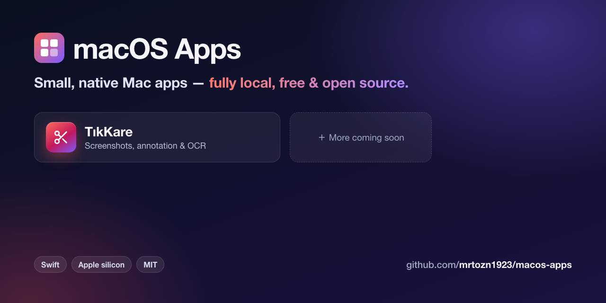

[English](README.md) | **Türkçe**

# macOS Uygulamaları

İhtiyaç duydukça yaptığım küçük, native ve tamamen yerel çalışan macOS uygulamaları.
Her uygulama kendi klasöründe, bağımsız olarak derlenir.

| Uygulama | Açıklama | Kaynak |
|---|---|---|
| [TıkKare](https://mrtozn1923.github.io/macos-apps/tikkare/?lang=tr) | Lightshot benzeri ekran görüntüsü aracı: alan / pencere / tam ekran / kaydırarak yakalama, çizim araçları, OCR. Tamamen yerel. | [`TikKare/`](TikKare/README.tr.md) |
| [NabızTut](https://mrtozn1923.github.io/macos-apps/nabiztut/?lang=tr) | Masaüstü uptime izleyici: web sitelerini, API'leri ve sunucuları (HTTP, ping, TCP) istediğin aralıkla kontrol eder; cevap süresi grafikleri ve düşüş bildirimleri sunar. Tamamen yerel. | [`NabizTut/`](NabizTut/README.tr.md) |

## Gereksinimler

- Apple silicon Mac
- Kaynaktan derlemek için Xcode (veya Xcode Command Line Tools) ile Swift 5.10+

## Lisans

[MIT](LICENSE)
