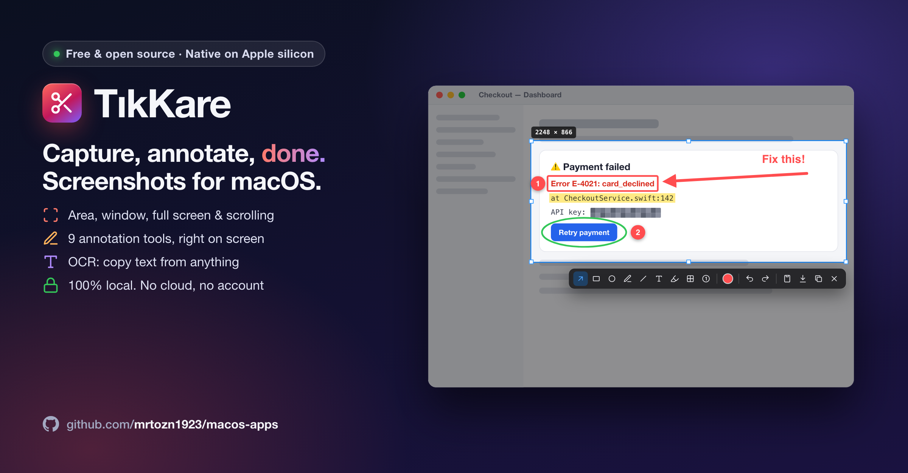

**English** | [Türkçe](README.tr.md)



# TıkKare

A Lightshot-style screenshot tool that lives in the menu bar. Native on Apple silicon;
nothing is ever uploaded, everything stays on your Mac.

> The app's interface is currently in Turkish. The shortcuts and tools below work the same either way.

## Features

- **Capture:** area selection, one-click window capture, full screen, long scrolling screenshots
- **Annotate on screen:** a toolbar appears right next to your selection; or open the capture in a separate editor window (with zoom)
- **Tools:** arrow, rectangle, ellipse, pen, line, text, highlighter, blur, numbered step badges, color and stroke width, undo / redo
- **OCR:** copies the text inside the selected area to the clipboard (Turkish + English)
- **Output:** copy to the clipboard or save as PNG (Retina resolution preserved)

## Shortcuts

| Shortcut | Action |
|---|---|
| `⌥⇧1` | Area / window |
| `⌥⇧2` | Full screen |
| `⌥⇧3` | Scrolling capture (press again to finish) |
| `⌥⇧4` | Capture text (OCR) |

Shortcuts can be changed in Settings.

**While annotating:** `Enter` / `⌘C` copy · `⌘S` save · `⌘⇧S` save as · `⌘E` open in editor ·
`⌘Z` / `⌘⇧Z` undo / redo · `Esc` cancel ·
`A R E P L T H B N` tools · `1`–`8` colors · `Shift` straight line / square.

**Selection:** resize with the corner and edge handles, move it by dragging its edge
(before the first annotation). Hold `Space` while drawing a selection to move it.

## Installation

### Prebuilt release

Download `TikKare.zip` from the [Releases](https://github.com/mrtozn1923/macos-apps/releases) page and move
`TikKare.app` into your `Applications` folder.

The app is not notarized by Apple, so macOS blocks it on first launch:

1. Try to open `TikKare.app` once.
2. Go to **System Settings › Privacy & Security** and click **Open Anyway**.

### Build from source

```bash
git clone https://github.com/mrtozn1923/macos-apps.git
cd macos-apps/TikKare
./scripts/build.sh --install
```

The app is installed to `~/Applications/TikKare.app` and launched. If an "Apple Development"
certificate is available on your Mac it is used for signing; otherwise the app is signed ad-hoc.
With ad-hoc signing, macOS asks for the Screen Recording permission again after every rebuild.

## Permissions

On the first capture TıkKare asks for **Screen & System Audio Recording** permission
(System Settings › Privacy & Security). You may need to restart TıkKare after granting it.

## Requirements

macOS 14 or later, Apple silicon.
